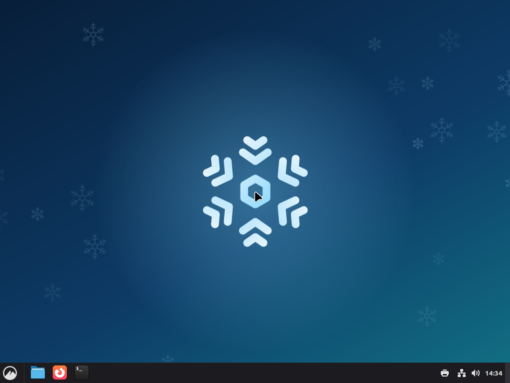

# Flocon

Un système d'exploitation basé sur NixOS 26.05, avec le bureau Cinnamon (celui de Linux Mint), son propre logo, fond d'écran et thème, et un installateur graphique en français.



## Construire

Il faut [Nix](https://nixos.org/download) (sur Arch : `sudo pacman -S nix`).

```bash
./build iso   # ISO amorçable : result-iso/iso/flocon-26.05-x86_64.iso
./build vm    # essayer Flocon dans une machine virtuelle
```

Pour mettre l'ISO sur une clé USB, copie-la sur une clé [Ventoy](https://www.ventoy.net) ou utilise `dd`.

## Contenu

- `configuration.nix` : le système (bureau, réseau, applications, identité visuelle)
- `installer.nix` : l'ISO et l'installateur Calamares aux couleurs de Flocon
- `branding/` : logos et images ; `python3 branding/generer.py` les régénère
- `installer-test` : lance l'ISO dans QEMU avec deux disques de test
